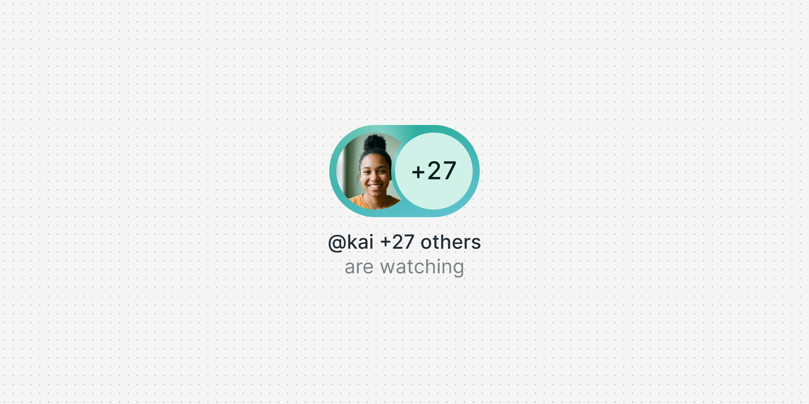
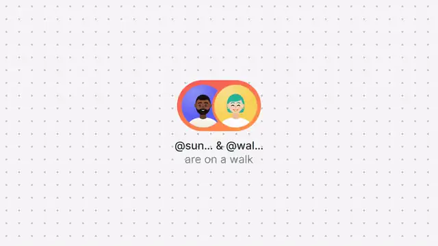

<p align="center">
  
</p>

<p align="center">
  <a href="https://likemiens.com/ui/presence"><b>Live demo</b></a> ·
  <a href="media/demo.mp4"><b>Video</b></a> ·
  <a href="#quick-start"><b>Quick start</b></a>
</p>

<p align="center">
  Made by Likemiens ·
  <a href="https://x.com/a_varantsov">X</a> ·
  <a href="https://t.me/Likemiens">Telegram</a> ·
  <a href="https://github.com/Likemiens">GitHub</a>
</p>

**presence** shows who is here and what they are doing, in one chip: a few faces, a head count and an activity. People come and go, the count rolls, and a light runs round the ring while something is live.

It is a single Web Component, `<lm-presence>`, with no dependencies: add one `<script>` and one tag, and it works on any site.

<p align="center">
  
</p>

## Features

- **Faces, a count and an activity.** The first people get faces, the rest turn into +N. Big numbers fit: 1,240 shows as 1.2K.
- **Alive.** Newcomers pop in, those who left fade out, the others slide into place, and the number rolls up or down.
- **One tag, any website.** One small file (~8 KB gzipped). No framework, no build step: plain HTML, React, Vue…
- **A real button or link.** Add `interactive` or `href` and you get focus, the keyboard and an `lm-select` event. Screen readers hear one sentence: "@walentina +2 others, are running".
- **Fits your page.** It takes your font and text colour; size, colours and parts are yours to change with CSS. Light or dark, English or Russian.
- **Calm when asked.** With "reduce motion" on, changes fade instead of moving.

## Quick start

Paste this anywhere in your HTML:

```html
<script src="https://cdn.jsdelivr.net/gh/Likemiens/presence@v1.0.3/presence.js" defer></script>

<lm-presence
  people='[
    {"name": "@walentina", "avatar": "https://cdn.jsdelivr.net/gh/Likemiens/presence@v1.0.3/avatars/walentina.svg"},
    {"name": "@kai", "avatar": "https://cdn.jsdelivr.net/gh/Likemiens/presence@v1.0.3/avatars/kai.svg"}
  ]'
  count="12"
  max="3"
  activity="are running"
  accent="#3b1fd1"
  interactive
></lm-presence>
```

You get two faces and +10 on a violet ring, with "@walentina +11 others" and "are running" under them. It is a button: a click fires `lm-select`.

> [!TIP]
> Always the latest version: `https://likemiens.com/ui/presence/presence.js`. It is served with `no-cache` and open to any origin, so fixes arrive by themselves. Pin a tag, as above, when you want a copy that never changes.

### With a bundler

```bash
npm i github:Likemiens/presence
```

```js
import "@likemiens/presence"; // registers <lm-presence>

const chip = document.querySelector("lm-presence");
chip.people = [{ name: "@walentina", avatar: "/avatars/walentina.jpg" }, { name: "@kai" }];
chip.count = 12;
chip.addEventListener("lm-select", (event) => openRoom(event.detail));
```

### React 19

React 19 passes properties and booleans straight to the element. Events come through a ref:

```jsx
import { useEffect, useRef } from "react";
import "@likemiens/presence";

export function Presence({ onSelect, ...props }) {
  const ref = useRef(null);
  useEffect(() => {
    const chip = ref.current;
    const select = (event) => onSelect?.(event.detail);
    chip.addEventListener("lm-select", select);
    return () => chip.removeEventListener("lm-select", select);
  }, [onSelect]);
  return <lm-presence ref={ref} {...props} />;
}

<Presence people={people} count={12} activity="are running" accent="#3b1fd1" interactive onSelect={openRoom} />
```

With server rendering (Next.js and the like), load it in the browser only, `useEffect(() => { import("@likemiens/presence"); }, [])`, and pass `people` as a JSON string: a string works even before the element is defined.

### Vue

Tell the compiler the tag is a custom element, and import `presence` before the app mounts:

```js
// vite.config.js
vue({ template: { compilerOptions: { isCustomElement: (tag) => tag.startsWith("lm-") } } })
```

```html
<lm-presence :people="people" :count="count" activity="are running" accent="#3b1fd1" interactive
  @lm-select="openRoom($event.detail)" />
```

## Options

Everything is set with HTML attributes. Each one is also a property: `chip.activity = "are here"`.

| Attribute | Default | What it does |
|---|---|---|
| `people` | `[]` | Who is there, in order, as JSON. The first get faces. See [People](#people) |
| `count` | the people listed | The whole head count, when you know of more people than you list. Never less than the people listed |
| `max` | `2` | Bubbles in the stack, +N included (1–6). With more people: `max − 1` faces, then +N |
| `activity` | — | The second line: what they are doing |
| `online` | off | The second line turns green, and says "online" when there is no activity |
| `accent` | — | Any CSS colour. Turns the ring on; its gradient and the +N tint come from it |
| `live` | off | A light runs round the ring. Needs a ring, so set `accent` too |
| `label` | the names | Replaces the line of names |
| `layout` | `stacked` | `inline` puts the text beside the faces instead of under them |
| `interactive` | off | Makes it a real `<button>` that fires `lm-select` |
| `href` | — | Makes it a link. `lm-select` fires first and can cancel the navigation |
| `disabled` | off | Dimmed, no hover, no events |
| `loading` | off | A skeleton of the same size while your data is on its way |
| `state` | — | `hover`, `active` or `focus`: holds that look, for previews and screenshots |
| `lang` | nearest `lang` | `ru` gets Russian wording, anything else English |

A boolean is on when present. `"false"` counts as off, so frameworks can pass `true` and `false`.

The line of names reads "@walentina", "@walentina & @kai" or "@walentina +11 others". With a count and nobody listed it says "1,240 people", and with zero, "No one yet".

### People

```ts
type Person = {
  id?: string;     // keeps a face in place while the list changes; the name by default
  name: string;    // shown as is: "@walentina", "Anna Petrova"
  avatar?: string; // image URL; initials on a tinted circle while it loads or if it fails
  color?: string;  // background behind the initials; picked from the name by default
};
```

## Events

| Event | `detail` | When |
|---|---|---|
| `lm-select` | `{ people, count }` | A click on an `interactive` or `href` chip, with the mouse or the keyboard. It bubbles out of the shadow DOM. `preventDefault()` keeps a link from opening |

## Styling

The chip takes the font family and the text colour of your page, so style `lm-presence` like text. The rest is CSS custom properties; set them on `lm-presence` or on any parent:

| Property | Default | What it does |
|---|---|---|
| `--lm-presence-size` | `56px` | Height of the faces. Spacing, type and the ring follow it |
| `--lm-presence-accent` | — | The `accent` attribute, set from CSS for many chips at once |
| `--lm-presence-ring` | from accent | Any background for the ring: a colour, a gradient, a picture |
| `--lm-presence-more-bg` | accent tint | Background of the +N bubble |
| `--lm-presence-more-color` | near black | The number in it |
| `--lm-presence-muted` | 58% of text | The second line |
| `--lm-presence-online` | `#18843c` / `#30d158` | The `online` line, for a light and a dark `color-scheme` |
| `--lm-presence-focus` | `#0c75f1` | The keyboard focus ring |
| `--lm-presence-label-width` | 1.9 × size | The narrowest column of text. Longer names get "…" |

On a dark page, set `color-scheme: dark` so the online green takes its dark shade.

For anything else, `::part()` reaches inside: `control` (the button or link), `bubble` (faces and ring), `ring`, `face`, `avatar`, `more` (+N), `label` (names) and `status` (the second line).

```css
lm-presence::part(label) { font-weight: 600; }
lm-presence::part(more) { font-family: ui-rounded, system-ui; }
```

## JavaScript API

```js
const chip = document.querySelector("lm-presence");

chip.people = [
  { id: "u1", name: "@walentina", avatar: "/avatars/walentina.jpg" },
  { id: "u2", name: "@kai" },
];
chip.count = 24;    // null: as many as the people listed
chip.live = true;   // every attribute is a property

chip.addEventListener("lm-select", (event) => {
  console.log(event.detail); // { people, count }
});

customElements.get("lm-presence").version; // "1.0.3"
```

Set `people` and `count` in the same tick and the chip redraws once. Assign a new array each time: changing `chip.people` in place does not redraw.

### TypeScript

`presence.d.ts` types the element, `querySelector("lm-presence")`, the `lm-select` event and `customElements.get("lm-presence")?.version`. A bundler picks it up from `import "@likemiens/presence"`; next to a script tag, add `/// <reference path="./presence.d.ts" />`. For JSX, declare the tag once:

```ts
/// <reference types="presence" />
import type { HTMLAttributes, Ref } from "react";

declare module "react" {
  namespace JSX {
    interface IntrinsicElements {
      "lm-presence": HTMLAttributes<LmPresenceElement> &
        Partial<Omit<LmPresenceElement, keyof HTMLElement | "people" | "count">> & {
          people?: LmPresencePerson[] | string;
          count?: number | null;
          ref?: Ref<LmPresenceElement>;
        };
    }
  }
}
```

## Browser support

Current Chrome, Edge and Firefox, and Safari 16.4 or newer. Where a browser lacks relative colours, the ring is the plain accent colour.

## Files

```
presence.js     the element: one file, no dependencies
presence.d.ts   TypeScript types
example.html    three chips to try it without a build
avatars/        the demo faces
media/          the cover, the preview and the video
AGENTS.md       notes for coding agents
```

`example.html` loads `./presence.js`: open it from the folder or through any static server.

## Author

Made by **Likemiens**. Say hi or share what you built: [X](https://x.com/a_varantsov) · [Telegram](https://t.me/Likemiens) · [GitHub](https://github.com/Likemiens)

## License

[MIT](LICENSE) © Likemiens
